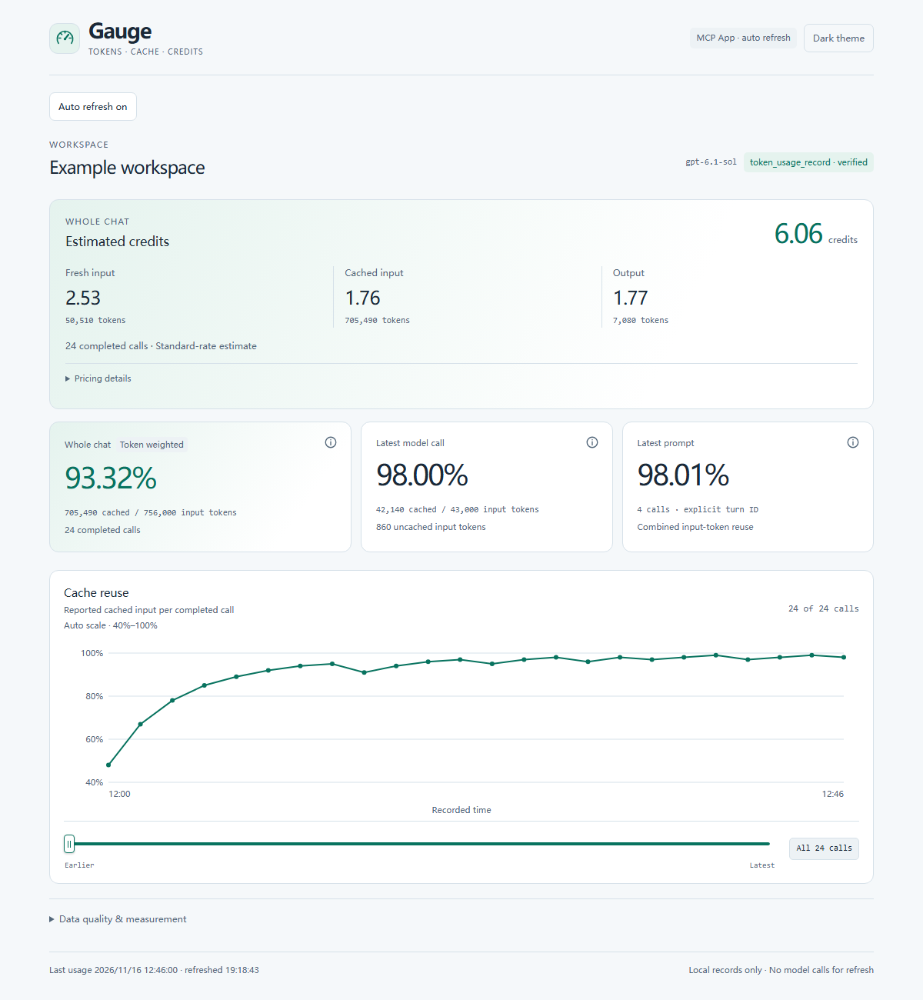

<h1 align="center">
  <picture>
    <source media="(prefers-color-scheme: dark)" srcset="assets/gauge-wordmark-dark.svg">
    <source media="(prefers-color-scheme: light)" srcset="assets/gauge-wordmark-light.svg">
    
  </picture>
</h1>

<h3 align="center">Token usage, cache reuse, and cost estimates for Claude Code and Codex</h3>

<p align="center"><strong>Tokens · Cache · Credits</strong></p>

<p align="center">
  <a href="https://github.com/alstomli/Gauge/actions/workflows/ci.yml"></a>
  <a href="https://github.com/alstomli/Gauge/releases/latest"></a>
  <a href="#how-it-works"></a>
  <a href="#supported-hosts"></a>
  <a href="LICENSE"></a>
</p>

<p align="center">
  <a href="#codex">Codex</a> ·
  <a href="#claude-code">Claude Code</a> ·
  <a href="#reading-the-dashboard">Dashboard</a> ·
  <a href="#troubleshooting">Troubleshooting</a> ·
  <a href="#local-data-and-privacy">Privacy</a> ·
  <a href="#faq">FAQ</a> ·
  <a href="CONTRIBUTING.md">Contributing</a>
</p>

Gauge is a local monitor for **Claude Code sessions** and **local Codex chats**. It shows token usage, prompt-cache reuse and a cost estimate for the chat you open it in, as a dashboard embedded in the conversation.

Gauge reads the usage logs those tools already write on your computer. Collection and dashboard refresh make **no model calls** and need no API key, hosted backend or separate browser dashboard. This is an independent project, not an OpenAI or Anthropic product or official-directory listing.

**Pick your host:**

| Host | Start here | Status |
| --- | --- | --- |
| Codex (local chats) | [Codex](#codex) | Dashboard with automatic refresh |
| Claude Code | [Claude Code](#claude-code) | Works, with one [known issue](#known-issue-no-automatic-refresh-in-the-claude-desktop-code-tab): in the Claude desktop app's Code tab the dashboard is a snapshot and does not refresh itself |

## What Gauge measures

- **Token usage** per completed model call: input, cached input, cache writes (Claude Code) and output.
- **Prompt-cache reuse**: the share of input tokens served from the cache, for the whole chat, the latest model call and the latest prompt.
- **Cost estimate**: estimated credits for Codex; API-equivalent USD at Anthropic list prices for Claude Code. Neither is a bill. See [Reading the dashboard](#reading-the-dashboard).

## Supported hosts

| Conversation | Supported | Why |
| --- | --- | --- |
| Claude Code session | Yes | Claude Code writes local transcripts with usage records |
| Local Codex chat | Yes | Codex writes local session logs with usage records |
| ChatGPT conversation (web, desktop, mobile) | No | No local usage logs |
| claude.ai chat (web, desktop, mobile) | No | No local usage logs |

An app's name alone does not establish compatibility. A desktop app can contain several modes: use a Claude Code session or a local chat in **Codex mode**.

The embedded dashboard needs a host that renders MCP Apps. Hosts that do not, such as the Claude Code terminal, show the same readings as text.

## Preview

Dark and light themes, shown with **synthetic sample usage**, not a real conversation. These images show the dashboard content; its placement and close controls depend on the desktop host.

| Dark theme | Light theme |
| --- | --- |
|  |  |

## Codex

Everything needed to run Gauge in local Codex chats. The Claude desktop refresh issue described under Claude Code does not affect Codex.

### Prerequisites for Codex

- A local Codex installation that writes compatible session logs, and an **MCP Apps-capable desktop host** for the embedded dashboard. Other MCP clients may expose the text tools for those local logs; ChatGPT conversations remain unsupported.
- [uv](https://docs.astral.sh/uv/getting-started/installation/) available to the host. Gauge runs on **Python 3.11+**; uv can provision a compatible Python, so a separate Python installation is not required.
- Git and a compatible Codex CLI that supports the plugin commands below. **Node.js is not needed to run Gauge.**

Check `uv --version` first. If you just installed uv, fully quit and reopen the desktop app so it inherits the updated PATH. First launch may download Python and dependencies.

### Install in Codex

```sh
codex plugin marketplace add alstomli/Gauge --ref main
codex plugin add gauge@gauge-tools
```

This adds Gauge's custom marketplace, separate from OpenAI's universal public directory. If your host exposes marketplace sources in its plugin directory, you can select Gauge under that source and install it there. See [the marketplace documentation](https://developers.openai.com/plugins/build/plugins#add-a-marketplace-from-the-cli).

Enable one Gauge connection: either the plugin or a [source installation](#install-from-source), so duplicate servers do not compete. Existing installations can keep the `cache-monitor` connection key and tool names.

### Open in Codex

Reload or restart your desktop host, then ask in a local Codex chat:

> Open Gauge for this chat.

The dashboard refreshes itself every two seconds while visible.

### Update in Codex

For the normal installation following `main`, refresh the marketplace and update Gauge:

```sh
codex plugin marketplace upgrade gauge-tools
codex plugin add gauge@gauge-tools
```

Reload or restart the host to load the updated tools and bundled skill. If Windows reports that plugin files are in use, fully quit the host before replacing them. **Updates retain your usage index**, which lives outside the plugin files.

<details>
<summary>Optional: pin a specific release</summary>

A new installation can pin release `v0.2.0` instead of following `main`:

```sh
codex plugin marketplace add alstomli/Gauge --ref v0.2.0
codex plugin add gauge@gauge-tools
```

A tag-pinned source stays on that tag until you change its reference. To replace an existing source reference, remove the marketplace source, then add the desired reference and install Gauge again:

```sh
codex plugin marketplace remove gauge-tools
codex plugin marketplace add alstomli/Gauge --ref v0.2.0
codex plugin add gauge@gauge-tools
```

To return to normal updates, use `--ref main` in the marketplace-add command instead. Source-reference replacement is separate from routine updates.

</details>

### Uninstall from Codex

Remove Gauge in the plugin UI, or run:

```sh
codex plugin remove gauge@gauge-tools
```

Optionally remove the custom source with `codex plugin marketplace remove gauge-tools`. For a separately registered MCP connection, run `codex mcp remove cache-monitor`.

Uninstalling retains usage data. See [PRIVACY.md](PRIVACY.md) for deliberate database deletion; never delete the entire Codex home.

## Claude Code

Everything needed to run Gauge in Claude Code sessions.

> **Known issue: no automatic refresh in the Claude desktop Code tab.** When Claude Code starts Gauge, the dashboard opens with correct numbers but cannot refresh itself, because of a Claude desktop bug ([anthropics/claude-code#106708](https://github.com/anthropics/claude-code/issues/106708)). Gauge shows a snapshot; ask Claude to open Gauge again for new readings. Details and an optional workaround are [below](#known-issue-no-automatic-refresh-in-the-claude-desktop-code-tab).

### Prerequisites for Claude Code

- Claude Code with plugin support. The commands below were checked against Claude Code 2.1.325.
- [uv](https://docs.astral.sh/uv/getting-started/installation/) on the PATH Claude Code inherits. Check `uv --version`. Gauge runs on **Python 3.11+**; uv can provision a compatible Python. **Node.js is not needed.**

If you just installed uv, fully quit and reopen Claude Code (or the Claude desktop app) so it inherits the updated PATH. First launch may download Python and dependencies.

### Install in Claude Code

```sh
claude plugin marketplace add alstomli/Gauge
claude plugin install gauge@gauge-tools
```

Inside a Claude Code session the same commands are `/plugin marketplace add alstomli/Gauge` and `/plugin install gauge@gauge-tools`.

Restart Claude Code afterwards. Use `/mcp` to check that the `cache-monitor` server is connected.

### Open in Claude Code

Ask in a session:

> Open Gauge for this chat.

The bundled skill passes the current session ID (`CLAUDE_CODE_SESSION_ID`). What you see depends on where the session runs:

| Where | What you get |
| --- | --- |
| Claude desktop app, Code tab | The dashboard, as a snapshot that does not refresh itself. See the [known issue](#known-issue-no-automatic-refresh-in-the-claude-desktop-code-tab) |
| Claude Code terminal (CLI) | No dashboard. Claude reports the tool's text summary, and you can ask for per-prompt or per-model detail. The known issue does not apply |

Cost figures for Claude Code are API-equivalent USD at Anthropic list prices, not what a subscription bills.

### Update in Claude Code

```sh
claude plugin marketplace update gauge-tools
claude plugin update gauge@gauge-tools
```

In a session, use the `/plugin` equivalents. Restart Claude Code to load the updated tools and bundled skill. Updates retain your usage index, which lives outside the plugin files.

### Uninstall from Claude Code

```sh
claude plugin uninstall gauge@gauge-tools
```

If you added the [desktop-config workaround](#optional-workaround-let-the-desktop-app-start-gauge), also remove its `gauge` entry from `claude_desktop_config.json`.

Uninstalling retains usage data. See [PRIVACY.md](PRIVACY.md) for deliberate database deletion.

### Known issue: no automatic refresh in the Claude desktop Code tab

**Symptom.** In the Claude desktop app's **Code tab**, the dashboard opens and its numbers are correct at that moment. Its own refresh calls then fail with:

```text
MCP error -32603: IPC not available for MCP tool call
```

**Cause.** This is a Claude desktop bug, [anthropics/claude-code#106708](https://github.com/anthropics/claude-code/issues/106708). The desktop app cannot forward a dashboard's tool calls to MCP servers that Claude Code owns. That covers both ways Claude Code starts Gauge: the plugin and `claude mcp add`. Gauge's server is running and its data is correct; reinstalling Gauge or uv does not help.

**What Gauge does.** Since 0.2.0 the dashboard detects this error, stops retrying and switches to snapshot mode. It shows **Auto refresh unavailable** and tells you to ask Claude to open Gauge again for new readings. Each time Claude opens Gauge, the readings are current.

**Who is affected.**

| Setup | Affected |
| --- | --- |
| Claude desktop Code tab, Gauge started by Claude Code (plugin or `claude mcp add`) | Yes: snapshot only |
| Claude desktop Code tab, Gauge started by the desktop app (workaround below) | No: automatic refresh works |
| Claude Code terminal (CLI) | Not applicable: text only, no dashboard |
| Codex | No |

#### Optional workaround: let the desktop app start Gauge

For automatic refresh in the Code tab, have the desktop app start Gauge itself instead of Claude Code. You need a Gauge folder on disk, for example a [source checkout](#install-from-source).

1. In Claude desktop, open **Settings → Developer → Edit Config**. This opens `claude_desktop_config.json`.
2. Add Gauge under `mcpServers`, using **absolute paths** to uv and to the Gauge folder. Keep the file's other settings.

   ```json
   {
     "mcpServers": {
       "gauge": {
         "command": "/absolute/path/to/uv",
         "args": ["run", "--locked", "--no-dev", "--project", "/absolute/path/to/Gauge", "gauge", "mcp"]
       }
     }
   }
   ```

   On Windows, write paths with forward slashes, such as `C:/Tools/Gauge`, or escape each backslash.
3. Fully quit and reopen the desktop app.
4. Ask Claude to open Gauge with the `gauge` server's tools.

Trade-offs:

- **Two sets of tools.** If the plugin is also installed, its `cache-monitor` tools stay loaded next to the `gauge` server's. The plugin's dashboard still cannot refresh in the Code tab, so the dashboard must be opened with the `gauge` server's tools.
- **Two server processes.** Each one runs its own collector.
- **Manual entry.** Plugin updates do not touch it. It runs whatever is in the folder it points to, so you update that folder yourself.
- **Temporary.** Remove the entry once the desktop bug is fixed.

## Reading the dashboard

The dashboard binds to the opening chat's **explicit ID**. It never silently selects a recently active unrelated chat. If that chat has no usage records yet, it waits for them. Automatic refresh runs every **two seconds while visible** where the host allows it (see the [Claude Code known issue](#known-issue-no-automatic-refresh-in-the-claude-desktop-code-tab)); the collector scans approximately every second.

| Reading | What it tells you |
| --- | --- |
| **Whole chat** | Token-weighted cache reuse across distinct recorded completed calls, including attempts replaced by editing a prompt |
| **Latest model call** | Cached input divided by input for the newest completed call |
| **Latest prompt** | Token-weighted cache reuse across calls attributed to the newest prompt with recorded usage; one prompt can cause several calls |
| **Estimated credits** (Codex) | Fresh input (`input − cached`), cached input and output priced separately at bundled per-model Standard-speed rates |
| **Estimated API cost** (Claude Code) | Fresh input, cache reads, cache writes (5-minute and 1-hour) and output priced in USD at Anthropic API list prices. A Claude subscription is not billed per token, so this is an API-equivalent figure |

Use the panel controls to change the history range and dark/light appearance. The percentage axis scales automatically. Info icons explain the readings. Animated credit amounts respect reduced-motion preferences.

**Credits and costs are estimates, not billed usage or remaining plan allowance.** The panel dates its rates, marks unknown rates as unpriced, and excludes speed/context surcharges and other charges. Local logs may be incomplete; see [accounting limits](#accounting-limits).

## How it works

Gauge is a Python MCP server that the host starts over stdio:

```sh
uv run --locked --no-dev --project <gauge-folder> gauge mcp
```

1. A collector thread reads the local logs about once a second: Codex session logs under `~/.codex/sessions` and Claude Code transcripts under `~/.claude/projects`.
2. It writes usage metadata to a local SQLite index: token counts, IDs, timestamps and model names, not conversation text.
3. The server exposes [tools](#tools-and-compatibility-names) that read the index, and an MCP App dashboard (`ui://cache-monitor/dashboard.html`) that the host renders inside the chat.
4. The dashboard refreshes by calling the server through the host. No model is involved, and Gauge makes no network calls at run time.

**Platform validation:** CI covers accounting, packaging and MCP launch/refresh on Windows, macOS and Linux with Python 3.11 and 3.13. Check the release commit's completed runs for its results. Windows desktop rendering has been exercised during development; native desktop rendering on macOS/Linux is **not yet verified**. See [validation details](docs/VALIDATION.md).

## Troubleshooting

| Symptom | Go to |
| --- | --- |
| "Gauge's tools are unavailable" | [Tools are unavailable](#tools-are-unavailable) |
| Empty panel or incomplete totals | [The panel is empty or totals look incomplete](#the-panel-is-empty-or-totals-look-incomplete) |
| "Auto refresh unavailable" or "IPC not available" | [The dashboard does not refresh in Claude desktop](#the-dashboard-does-not-refresh-in-claude-desktop) |
| No dashboard in the Claude Code terminal | [No dashboard in the Claude Code terminal](#no-dashboard-in-the-claude-code-terminal) |
| `gauge mcp` seems to hang | [The server appears to hang in a terminal](#the-server-appears-to-hang-in-a-terminal) |

### Tools are unavailable

Start with the conversation type. Gauge supports Claude Code sessions and local Codex chats; open one and ask "Open Gauge for this chat." Installing dependencies or reconnecting does not add ChatGPT or claude.ai support.

Then check `uv --version`. A missing uv executable prevents the MCP server from starting, but an unavailable-tools message alone does not establish the cause. Use [Astral's installation instructions](https://docs.astral.sh/uv/getting-started/installation/) if needed, then fully quit and reopen the host. If uv works in a terminal, inspect the MCP startup error: the host may have inherited a different PATH, or dependency setup may have failed. In Claude Code, `/mcp` shows the `cache-monitor` server's status and can reconnect it, and `claude --debug` prints MCP startup errors.

The plugin bundles a Gauge skill and setup entry that can guide startup diagnosis even when its MCP server cannot start. In a host that loads the skill, ask **"Diagnose Gauge startup"**, or use its setup action. Discovery, setup availability and automatic skill invocation depend on the host.

### The panel is empty or totals look incomplete

Gauge waits for completed calls in the selected chat's compatible local logs. Check that the chat has recorded usage and the configured log directory is available. Cloud-only calls, other devices and separate agent chats do not enter this chat's totals. See the [accounting limits](#accounting-limits) before comparing against account-wide usage.

### The dashboard does not refresh in Claude desktop

The dashboard says **Auto refresh unavailable**, or reports `MCP error -32603: IPC not available for MCP tool call`. This is the [Claude Code known issue](#known-issue-no-automatic-refresh-in-the-claude-desktop-code-tab), not a Gauge installation problem. Ask Claude to open Gauge again for current readings, or use the [workaround](#optional-workaround-let-the-desktop-app-start-gauge).

If you set up the workaround and the dashboard still does not refresh, check that it was opened with the `gauge` server's tools rather than the plugin's `cache-monitor` tools, and that you fully quit and reopened the desktop app after editing the config.

### No dashboard in the Claude Code terminal

This is expected. The terminal shows the tool's text summary. Ask for per-prompt or per-model detail if you need more.

### The server appears to hang in a terminal

`gauge mcp` waits for MCP messages on stdin; it is not an interactive web server. For a source-install launch check, use `uv run --locked gauge --version`.

## Local data and privacy

In short:

- Gauge reads local log files only. It has no telemetry, hosted backend or HTTP dashboard.
- The index stores numbers and metadata, not prompt text, responses or tool output.
- Usage metadata you request is returned to the MCP host and model, and follows the host's own privacy rules.
- Uninstalling keeps the index. Deleting it is a deliberate step described in [PRIVACY.md](PRIVACY.md).

| Setting | Default | Override |
| --- | --- | --- |
| Codex log directory | `$CODEX_HOME/sessions`, otherwise `~/.codex/sessions` | `--logs` |
| Claude Code transcripts | `$CLAUDE_CONFIG_DIR/projects`, otherwise `~/.claude/projects` | `--claude-logs`; `--no-claude` disables |
| Gauge usage index | `$CODEX_HOME/gauge/usage.sqlite3`, otherwise `~/.codex/gauge/usage.sqlite3`; with no Codex home, `~/.claude/gauge/usage.sqlite3` | `GAUGE_DATABASE` or `--database` |

Gauge indexes all readable local chats in that directory. The dashboard returns only its selected chat; the separate list tool can return other indexed summaries. The index stores numeric usage, IDs, timestamps, model/source metadata and local paths. It does not intentionally store prompt text, responses, tool output or credentials. Requested usage metadata is shared with the MCP host/model and follows the host's own privacy rules.

Gauge has **no telemetry** or hosted refresh service. Dependency installation contacts package registries; opening the optional pricing link uses the host's browser integration. Rates are bundled, not fetched on refresh.

Older explicit database paths, including `.monitor/usage.sqlite3`, remain supported and are not automatically migrated. Stop Gauge before copying an old SQLite database, or let a new default index rebuild from retained logs. Read [PRIVACY.md](PRIVACY.md) before sharing diagnostics or deleting data.

## Accounting limits

Cache reuse is `sum(cached input) / sum(input)`. Cached input is already included in input; output does not enter this percentage. Zero input is unavailable, and unfinished calls have no reported usage yet.

- **Recorded usage, not account-wide billing.** Only compatible, retained local logs are covered. Archives, other devices, cloud-only calls and separate agent chats are excluded from this chat's totals. Codex's internal log format can change.
- **Claude Code transcripts.** Each model call is counted once by message ID, even when Claude Code splits it across several records. Input is the sum of uncached input, cache reads and cache writes, so cache reuse means the same as for Codex. Prompts group by Claude Code's prompt ID. Subagent calls form separate sessions. Transcripts carry no running totals, so Claude Code readings show as unreconciled rather than verified. Fast mode and long-context surcharges are excluded from cost estimates. Claude Code's transcript format can change.
- **Completed attempts still count.** Responses are deduplicated by chat and response ID. Completed calls omitted from the surviving conversation branch still count toward spent usage. Child-agent and internal-review usage stays separate from the parent chat.
- **Verification depends on evidence.** Each log is checked against its own resume-checkpoint lineage, including nested segment references after edits. Missing proof stays unverified; actual counter mismatches are marked degraded. For snapshot-only logs, the first cumulative value is a baseline and history is explicitly partial.

## Install from source

Use this alternative for development, a manually managed connection, or the Claude desktop [workaround](#optional-workaround-let-the-desktop-app-start-gauge). You need Git and uv; uv can provision Python 3.11+.

```sh
git clone https://github.com/alstomli/Gauge.git
cd Gauge
uv sync --locked
uv run --locked gauge --version
```

Register the server with your **absolute checkout path**, so it works from any project.

For Codex:

```sh
codex mcp add cache-monitor -- uv run --locked --no-dev --project "/absolute/path/to/Gauge" gauge mcp
```

For Claude Code:

```sh
claude mcp add --scope user cache-monitor -- uv run --locked --no-dev --project "/absolute/path/to/Gauge" gauge mcp
```

A server added with `claude mcp add` is still started by Claude Code, so the [Code tab known issue](#known-issue-no-automatic-refresh-in-the-claude-desktop-code-tab) applies to it as well.

On Windows, use a path such as `C:/Tools/Gauge`. For clients accepting JSON settings, `uv run --locked gauge config` prints a configuration using that environment's Python interpreter.

For a release ZIP, extract it, run `uv sync --locked` in that folder, then use the same registration command. A wheel can be installed with `python -m pip install /path/to/codex_cache_monitor-0.2.0-py3-none-any.whl`. Dependencies must be downloadable unless cached. To update a checkout, stop/reload the connection, pull the desired release, run `uv sync --locked`, then reconnect.

## Tools and compatibility names

| Tool | Purpose |
| --- | --- |
| `show_cache_dashboard` | Open the embedded dashboard for an explicit current chat ID |
| `refresh_cache_dashboard` | App-only passive refresh |
| `list_cache_sessions` | List indexed chats; internal reviews hidden by default |
| `get_cache_summary` | Whole-chat, latest-call and latest-prompt readings |
| `get_cache_history` | Completed call history and prompt groups |

Gauge is the displayed name. For compatibility, the package retains `cache_monitor`, distribution name `codex-cache-monitor`, resource URI `ui://cache-monitor/dashboard.html`, and existing tool/connection names. The `gauge` and legacy `cache-monitor` entry points are equivalent.

## FAQ

**Does Gauge use tokens?** Collection and dashboard refresh make no model calls. Opening Gauge, or asking for a summary or history, is a tool call in your conversation, so its short result is part of that conversation like any other tool result.

**Why does the Claude Code cost differ from what I pay?** Gauge prices recorded tokens at Anthropic API list prices. A Claude subscription is not billed per token, so the figure is an API-equivalent estimate, not a bill.

**Why do the totals differ from my account usage?** Gauge only sees logs retained on this computer, for the chat you opened it in. See [accounting limits](#accounting-limits).

**Can it monitor ChatGPT or claude.ai chats?** No. Those conversations leave no local usage logs for Gauge to read.

**Are subagents included?** No. Subagent and child-agent usage forms separate sessions and stays out of the parent chat's totals.

**Does updating or uninstalling delete my history?** No. The index lives outside the plugin files. See [PRIVACY.md](PRIVACY.md) to delete it deliberately.

## Development and releases

See [CONTRIBUTING.md](CONTRIBUTING.md) for setup and checks, [CHANGELOG.md](CHANGELOG.md) for changes, [SECURITY.md](SECURITY.md) for reporting, and [the release checklist](docs/RELEASING.md) for artifact review and publication.

Development additionally requires Node.js 20+. Build the UI before Python resource tests. Release ZIPs use an explicit file allowlist and per-file hash manifest; `dist/SHA256SUMS` covers the generated artifacts. Use synthetic fixtures and never publish your development folder wholesale.

To reproduce the screenshots, run `node scripts/screenshot_preview.mjs` after `npm ci`, then capture `.release-test/screenshot-preview/dark.html` and `light.html` at 1200 × 1300 pixels. The preview uses the production UI with a simulated MCP host and does not read local chat logs.

## License

[MIT](LICENSE). Dependencies retain their own licenses; see [THIRD_PARTY_NOTICES.md](THIRD_PARTY_NOTICES.md).
