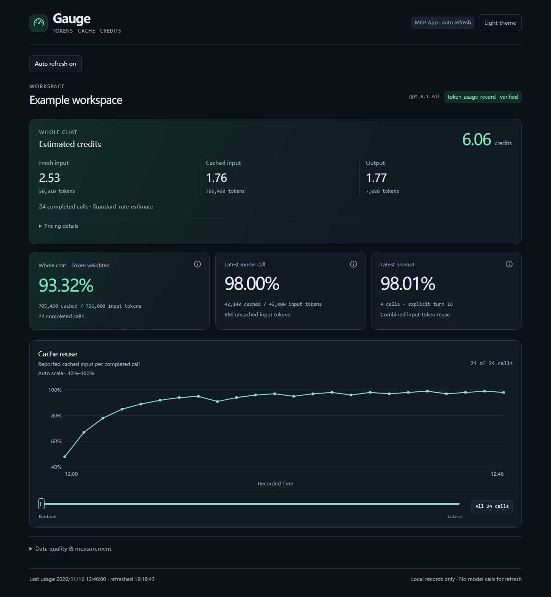

# Gauge

**Tokens · Cache · Credits.** See token usage, prompt-cache reuse and estimated credits for your local Codex chat in an embedded MCP dashboard.

> **Codex only.** Gauge does not support ChatGPT conversations on web, desktop or mobile. If your desktop app offers both ChatGPT and Codex modes, open a local chat in **Codex mode**. The app's name alone does not establish compatibility.

[](https://github.com/alstomli/Gauge/actions/workflows/ci.yml)

[Quick start](#quick-start) · [Using Gauge](#using-gauge) · [Updates](#updates-and-uninstall) · [Troubleshooting](#troubleshooting) · [Privacy](PRIVACY.md) · [Contributing](CONTRIBUTING.md)

Gauge reads existing local logs. Collection and dashboard refresh make **no model calls** and require no OpenAI API key, hosted backend or separate browser dashboard. This is an independent project, not an OpenAI product or official-directory listing.

## Preview

Dark and light themes, shown with **synthetic sample usage**, not a real conversation. These images show the dashboard content; its placement and close controls depend on the desktop host.

| Dark theme | Light theme |
| --- | --- |
|  |  |

## Quick start

You need:

- A local Codex installation that writes compatible session logs, and an **MCP Apps-capable desktop host** for the embedded dashboard. Other MCP clients may expose the text tools for those local logs; ChatGPT conversations remain unsupported.
- [uv](https://docs.astral.sh/uv/getting-started/installation/) available to the host. Gauge runs on **Python 3.11+**; uv can provision a compatible Python, so a separate Python installation is not required.
- Git and a compatible Codex CLI that supports the plugin commands below. **Node.js is not needed to run Gauge.**

Check `uv --version` first. If you just installed uv, fully quit and reopen the desktop app so it inherits the updated PATH. First launch may download Python and dependencies.

**1. Add the marketplace and install Gauge:**

```sh
codex plugin marketplace add alstomli/Gauge --ref main
codex plugin add gauge@gauge-tools
```

This adds Gauge's custom marketplace, separate from OpenAI's universal public directory. If your host exposes marketplace sources in its plugin directory, you can select Gauge under that source and install it there. See [the marketplace documentation](https://developers.openai.com/plugins/build/plugins#add-a-marketplace-from-the-cli).

**2. Reload or restart your desktop host, then ask in a local Codex chat:**

> Open Gauge for this chat.

Enable one Gauge connection: either the plugin or a [source installation](#install-from-source), so duplicate servers do not compete. Existing installations can keep the `cache-monitor` connection key and tool names.

**Platform validation:** CI covers accounting, packaging and MCP launch/refresh on Windows, macOS and Linux with Python 3.11 and 3.13. Check the release commit's completed runs for its results. Windows desktop rendering has been exercised during development; native desktop rendering on macOS/Linux is **not yet verified**. See [validation details](docs/VALIDATION.md).

## Using Gauge

The dashboard binds to the opening chat's **explicit ID**. It never silently selects a recently active unrelated chat. If that chat has no usage records yet, it waits for them. Automatic refresh runs every **two seconds while visible**; the collector scans approximately every second.

| Reading | What it tells you |
| --- | --- |
| **Whole chat** | Token-weighted cache reuse across distinct recorded completed calls, including attempts replaced by editing a prompt |
| **Latest model call** | Cached input divided by input for the newest completed call |
| **Latest prompt** | Token-weighted cache reuse across calls attributed to the newest prompt with recorded usage; one prompt can cause several calls |
| **Estimated credits** | Fresh input (`input − cached`), cached input and output priced separately at bundled per-model Standard-speed rates |

Use the panel controls to change the history range and dark/light appearance. The percentage axis scales automatically. Info icons explain the readings. Animated credit amounts respect reduced-motion preferences.

**Credits are estimates, not billed usage or remaining plan allowance.** The panel dates its rates, marks unknown rates as unpriced, and excludes speed/context surcharges and other charges. Local logs may be incomplete; see [accounting limits](#accounting-limits).

## Updates and uninstall

For the normal installation following `main`, refresh the marketplace and update Gauge:

```sh
codex plugin marketplace upgrade gauge-tools
codex plugin add gauge@gauge-tools
```

Reload or restart the host to load the updated tools and bundled skill. If Windows reports that plugin files are in use, fully quit the host before replacing them. **Updates retain your usage index**, which lives outside the plugin files.

<details>
<summary>Optional: pin a specific release</summary>

A new installation can pin release `v0.1.2` instead of following `main`:

```sh
codex plugin marketplace add alstomli/Gauge --ref v0.1.2
codex plugin add gauge@gauge-tools
```

A tag-pinned source stays on that tag until you change its reference. To replace an existing source reference, remove the marketplace source, then add the desired reference and install Gauge again:

```sh
codex plugin marketplace remove gauge-tools
codex plugin marketplace add alstomli/Gauge --ref v0.1.2
codex plugin add gauge@gauge-tools
```

To return to normal updates, use `--ref main` in the marketplace-add command instead. Source-reference replacement is separate from routine updates.

</details>

To uninstall the marketplace plugin, remove Gauge in the plugin UI or run `codex plugin remove gauge@gauge-tools`. For a separately registered MCP connection, run `codex mcp remove cache-monitor`. Optionally remove the custom source with `codex plugin marketplace remove gauge-tools`.

Uninstalling retains usage data. See [PRIVACY.md](PRIVACY.md) for deliberate database deletion; never delete the entire Codex home.

## Troubleshooting

**“Gauge's tools are unavailable.”** Start with the conversation type. Gauge currently supports local Codex chats only; open one and ask “Open Gauge for this chat.” Installing dependencies or reconnecting does not add ChatGPT conversation support.

In a Codex chat, check `uv --version`. A missing uv executable prevents the MCP server from starting, but an unavailable-tools message alone does not establish the cause. Use [Astral's installation instructions](https://docs.astral.sh/uv/getting-started/installation/) if needed, then fully quit and reopen the desktop app. If uv works in a terminal, inspect the MCP startup error: the host may have inherited a different PATH, or dependency setup may have failed.

The plugin bundles a Gauge skill and setup entry that can guide startup diagnosis even when its MCP server cannot start. In a host that loads the skill, ask **“Diagnose Gauge startup”**, or use its setup action. Discovery, setup availability and automatic skill invocation depend on the host.

**The panel is empty or totals look incomplete.** Gauge waits for completed calls in the selected chat's compatible local logs. Check that the chat has recorded usage and the configured log directory is available. Cloud-only calls, other devices and separate agent chats do not enter this chat's totals. See the limits below before comparing against account-wide usage.

**The server appears to hang in a terminal.** `gauge mcp` waits for MCP messages on stdin; it is not an interactive web server. For a source-install launch check, use `uv run --locked gauge --version`.

## Local data and privacy

| Setting | Default | Override |
| --- | --- | --- |
| Codex log directory | `$CODEX_HOME/sessions`, otherwise `~/.codex/sessions` | `--logs` |
| Gauge usage index | `$CODEX_HOME/gauge/usage.sqlite3`, otherwise `~/.codex/gauge/usage.sqlite3` | `GAUGE_DATABASE` or `--database` |

Gauge indexes all readable local chats in that directory. The dashboard returns only its selected chat; the separate list tool can return other indexed summaries. The index stores numeric usage, IDs, timestamps, model/source metadata and local paths. It does not intentionally store prompt text, responses, tool output or credentials. Requested usage metadata is shared with the MCP host/model and follows the host's own privacy rules.

Gauge has **no telemetry** or hosted refresh service. Dependency installation contacts package registries; opening the optional pricing link uses the host's browser integration. Rates are bundled, not fetched on refresh.

Older explicit database paths, including `.monitor/usage.sqlite3`, remain supported and are not automatically migrated. Stop Gauge before copying an old SQLite database, or let a new default index rebuild from retained logs. Read [PRIVACY.md](PRIVACY.md) before sharing diagnostics or deleting data.

## Accounting limits

Cache reuse is `sum(cached input) / sum(input)`. Cached input is already included in input; output does not enter this percentage. Zero input is unavailable, and unfinished calls have no reported usage yet.

- **Recorded usage, not account-wide billing.** Only compatible, retained local logs are covered. Archives, other devices, cloud-only calls and separate agent chats are excluded from this chat's totals. Codex's internal log format can change.
- **Completed attempts still count.** Responses are deduplicated by chat and response ID. Completed calls omitted from the surviving conversation branch still count toward spent usage. Child-agent and internal-review usage stays separate from the parent chat.
- **Verification depends on evidence.** Each log is checked against its own resume-checkpoint lineage, including nested segment references after edits. Missing proof stays unverified; actual counter mismatches are marked degraded. For snapshot-only logs, the first cumulative value is a baseline and history is explicitly partial.

## Install from source

Use this alternative for development or a manually managed connection. You need Git and uv; uv can provision Python 3.11+.

```sh
git clone https://github.com/alstomli/Gauge.git
cd Gauge
uv sync --locked
uv run --locked gauge --version
```

Register the server with your **absolute checkout path**, so it works from any project:

```sh
codex mcp add cache-monitor -- uv run --locked --no-dev --project "/absolute/path/to/Gauge" gauge mcp
```

On Windows, use a path such as `C:/Tools/Gauge`. For clients accepting JSON settings, `uv run --locked gauge config` prints a configuration using that environment's Python interpreter.

For a release ZIP, extract it, run `uv sync --locked` in that folder, then use the same registration command. A wheel can be installed with `python -m pip install /path/to/codex_cache_monitor-0.1.2-py3-none-any.whl`. Dependencies must be downloadable unless cached. To update a checkout, stop/reload the connection, pull the desired release, run `uv sync --locked`, then reconnect.

### Tools and compatibility names

| Tool | Purpose |
| --- | --- |
| `show_cache_dashboard` | Open the embedded dashboard for an explicit current chat ID |
| `refresh_cache_dashboard` | App-only passive refresh |
| `list_cache_sessions` | List indexed chats; internal reviews hidden by default |
| `get_cache_summary` | Whole-chat, latest-call and latest-prompt readings |
| `get_cache_history` | Completed call history and prompt groups |

Gauge is the displayed name. For compatibility, the package retains `cache_monitor`, distribution name `codex-cache-monitor`, resource URI `ui://cache-monitor/dashboard.html`, and existing tool/connection names. The `gauge` and legacy `cache-monitor` entry points are equivalent.

## Development and releases

See [CONTRIBUTING.md](CONTRIBUTING.md) for setup and checks, [CHANGELOG.md](CHANGELOG.md) for changes, [SECURITY.md](SECURITY.md) for reporting, and [the release checklist](docs/RELEASING.md) for artifact review and publication.

Development additionally requires Node.js 20+. Build the UI before Python resource tests. Release ZIPs use an explicit file allowlist and per-file hash manifest; `dist/SHA256SUMS` covers the generated artifacts. Use synthetic fixtures and never publish your development folder wholesale.

To reproduce the screenshots, run `node scripts/screenshot_preview.mjs` after `npm ci`, then capture `.release-test/screenshot-preview/dark.html` and `light.html` at 1200 × 1300 pixels. The preview uses the production UI with a simulated MCP host and does not read local chat logs.

## License

[MIT](LICENSE). Dependencies retain their own licenses; see [THIRD_PARTY_NOTICES.md](THIRD_PARTY_NOTICES.md).
